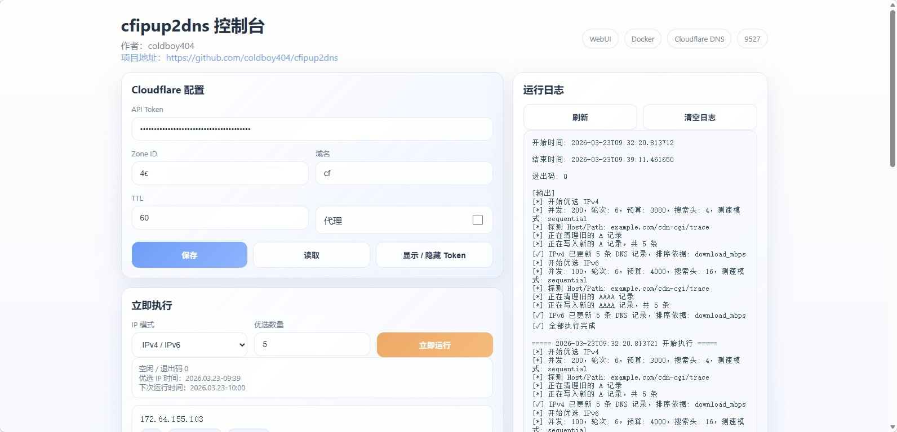
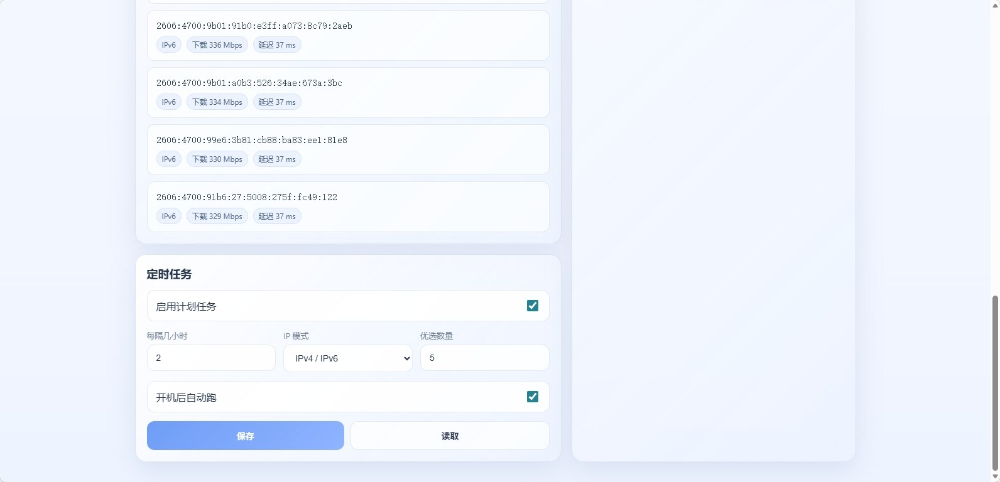

# cfipup2dns

Cloudflare IPv4 / IPv6 优选与自动 DDNS。提供 WebUI、定时任务、限时下载测速、多域名同步和结果导出，支持 **Docker** 与 **Linux 原生一键安装**。

[](https://github.com/coldboy404/cfipup2dns/pkgs/container/cfipup2dns)

## 快速部署

两种方式任选其一，**不要在同一个端口同时运行两套服务**。安装、更新不会主动触发优选或修改 DNS；已有定时任务仍按保存的计划运行。

### 方式一：Docker Compose

```bash
git clone https://github.com/coldboy404/cfipup2dns.git
cd cfipup2dns
bash docker/up.sh
```

默认访问 `http://服务器IP:9527`，数据保存在当前目录的 `./data`。只应在可信内网使用；开启认证可在私有 `.env` 中设置 `WEB_USERNAME` 和 `WEB_PASSWORD`，公网访问还需 HTTPS 与访问控制。

```bash
# 更新：不会删除配置、结果或自定义地址库
git pull --ff-only
bash docker/up.sh

# 状态、日志、停止
docker compose ps
docker compose logs -f
docker compose down

# 可选：从当前源码构建
BUILD_LOCAL=1 bash docker/up.sh
```

镜像：`ghcr.io/coldboy404/cfipup2dns:latest`，支持 `linux/amd64`、`linux/arm64`。可用 `sha-xxxxxxx` 固定提交，正式版本另有 `vX.Y.Z` 标签。镜像内已预编译扫描程序，启动时无需 Go 或现场编译。GHCR 不可达时需先解决 Docker 的镜像拉取网络，不要让测速流量经过应用层代理。

### 方式二：Linux 原生一键安装（无需 Docker）

适用 **Linux x86_64 / ARM64、systemd、Python 3.9+**。使用 root 或 sudo 执行，脚本从 GitHub Release 下载对应架构的预编译包并校验 SHA256，无需安装 Go。

```bash
curl -fsSL https://raw.githubusercontent.com/coldboy404/cfipup2dns/main/install.sh -o cfip-install.sh && sudo bash cfip-install.sh
```

默认监听 `127.0.0.1:9527`，启用账号认证，首次安装会显示生成的登录凭据。远程使用可建立 SSH 隧道后访问 `http://127.0.0.1:9527`：

```bash
ssh -L 9527:127.0.0.1:9527 root@服务器IP
```

如需直接在内网访问，**首次安装**时指定实际内网 IP；不要填写公网 IP：

```bash
sudo env WEB_BIND_HOST=192.168.66.33 PORT=9527 bash cfip-install.sh
```

安装后由 systemd 管理，支持开机自启、异常重启：

```bash
cfip status                 # 查看状态
cfip logs                   # 查看日志
cfip restart                # 重启
cfip stop                   # 停止
cfip start                  # 启动
cfip update                 # 保留配置更新
cfip uninstall              # 卸载程序，默认保留数据
```

原生安装的程序、数据与 Docker 分开，不会自动迁移或停止现有容器。端口冲突会拒绝安装，不会抢占。请保管安装生成的私有环境文件；更新时保留原有账号、监听设置、Cloudflare 配置和结果。

## 首次使用

1. 打开 WebUI，填写 **Cloudflare API Token**。权限至少为 `Zone / Zone / Read` 和 `Zone / DNS / Edit`，建议仅授权目标域名。
2. 域名一行一个，支持 `域名|Zone ID`；不填 Zone ID 会自动识别：

   ```text
   cf.example.com
   cf.example.net|你的ZoneID
   ```

3. 保存配置，在“立即执行”选择地址族与优选数量。建议先勾选 **仅测速** 检查线路，确认结果后再执行 DNS 同步。
4. 需要自动运行时，在“定时任务”单独设置并保存。手动运行设置和定时计划互相独立。

已保存 Token 不会回传页面；留空保存会保留旧 Token。优选数量是**每个地址族**的目标上限：双栈设 10，代表 IPv4 最多 10 条、IPv6 最多 10 条，不保证任何网络环境都能凑满。

## 下载测速与时间预算

扫描使用 `montecarlo-ip-searcher`，下载改用独立的直连限时采样器。正常收到响应后，在采样窗口内读取字节流并计算 **Mbps**，不要求慢线路必须下载完整 50 MB；测速内容不落盘。

- 默认采样 **6 秒**，达到字节上限或正常 EOF 可提前结束。
- 主动采样窗口到期与异常超时、断流分开处理；异常部分字节不算有效速度。
- 直接连接待测 IP，验证测速域名 TLS / SNI / Host，不使用环境代理，不跟随重定向。
- 串行测速避免多个候选争抢带宽；`sequential` 达到本族所需合格数量后停止，`all` 测试预算内候选。
- 下载尝试上限为 `max(配置值, 本族优选数量 × 2)`，最多 50，并受有效候选数与总预算限制；配置为 `0` 关闭下载。
- 扫描进度、每条下载结果、预算截止和数量汇总会实时显示在日志里。
- 历史成绩显示采样时间；没有时间信息的旧成绩明确标记，不代表本轮测速通过。

高级参数可在网页修改；环境变量提供初始默认值，已保存配置优先：

| 参数 | 默认值 | 含义 |
|---|---|---|
| `TIMEOUT` | `6s` | 单次扫描探测超时 |
| `ROUNDS` | `6` | 扫描探测轮次 |
| `DOWNLOAD_TOP` | `8` | 下载尝试数基线，0 关闭 |
| `DOWNLOAD_WINDOW` | `6s` | 响应体采样窗口，100ms～30s |
| `DOWNLOAD_TIMEOUT` | `15s` | 单 IP 总超时，实际不超过采样窗口加 9 秒连接余量 |
| `DOWNLOAD_BUDGET` | `180s` | 每地址族下载总时间预算，1s～30m |
| `MAX_SCAN_SECONDS` | `300` | 每族扫描上限（秒），显式 0 不限 |
| `DOWNLOAD_MODE` | `sequential` | 达标即停或 `all` 测试预算内候选 |
| `DOWNLOAD_URL` | 空 | 留空使用 Cloudflare 官方测速源 |
| `MIN_DOWNLOAD_MBPS` | `0` | 最低下载速度，0 不限制 |
| `MAX_LATENCY_MS` / `MIN_LATENCY_MS` | `0` | 延迟范围，0 不限制 |
| `MAX_LOSS_RATE` | `1` | HTTPS 重复复测失败率上限，0～1 |
| `CF_COLO` | 空 | 机房筛选，例如 `HKG,NRT,SJC` |
| `KEEP_LAST_ON_FAIL` | `true` | 无新结果时保留原 DNS 与结果 |

旧配置的 `90s` 下载超时会按采样窗口加连接余量收紧。**扫描上限和下载预算不包含后续 HTTPS 复验与 DNS API 重试时间**，不是整轮任务总耗时保证。未测速候选仅在没有最低速度门槛时可作为备用，不会冒充已测速结果；启用速度/延迟/地区/失败率筛选时，缺少必需指标会被拒绝。

## IPv6 网络

原生安装直接使用宿主机网络。Docker 默认 bridge 未必具备 IPv6，即使宿主机能访问 IPv6，容器也可能没有出口。明确无本地 IPv6 路由时程序会跳过本族扫描、报告 `network_unavailable` 并保留现有 DNS；路由检查本身不保证公网可达。

Linux 宿主机已经有可用 IPv6 时，可选 host 网络；需 Docker Compose 2.24.4+：

```bash
# 先验证，再部署。改为实际内网 IP。
WEB_BIND_HOST=192.168.66.33 docker compose -f docker-compose.yml -f docker-compose.host.yml config --quiet
WEB_BIND_HOST=192.168.66.33 NETWORK_MODE=host bash docker/up.sh
```

host 模式没有 Docker 端口映射隔离，默认只监听 loopback；内网访问必须显式指定 `WEB_BIND_HOST`。更新时保持相同 overlay 与参数。需要持久使用时，将以下内容加入私有 `.env`，保留已有认证字段：

```dotenv
COMPOSE_FILE=docker-compose.yml:docker-compose.host.yml
NETWORK_MODE=host
WEB_BIND_HOST=192.168.66.33
```

回退 bridge 时删除/调整这三项，并执行 `NETWORK_MODE=bridge bash docker/up.sh`；未经配置 IPv6 的 bridge 仍无法进行 IPv6 优选。镜像更新不会修改宿主机、Docker 全局网络或路由器。

## DNS 安全策略

- 下载用于候选排序/筛选，**最终正常替换按本轮新旧 IP 的 HTTPS 直连总耗时比较**，不按历史下载速度自动切换。
- 默认至少改善 **20%**、正常切换间隔 **6 小时**；现有 IP 连续 **2 轮全部复测失败**才故障替换。每轮复测 3 次、单次 5 秒，验证证书与 Host。
- 从 5 条扩到 10 条时，只补入同轮复验全部通过的候选，不受正常替换冷却限制；无合格候选不凑数。缩容保留不确定或失败的旧记录保护，可能暂时超过目标数量。
- 每个域名独立差异同步，写入后从 Cloudflare API 回读核对 IP、TTL 和代理状态；回读成功才推进本地切换状态。
- API 回读不等于公网递归 DNS 已传播，也不是跨域名事务。中途失败可能已有部分写入，不会自动回滚；失败地址族保留旧结果文件，页面不保证代表所有域名当下状态。
- “停止任务”会终止当前测速进程组，不撤销已经提交的 DNS 修改。仅测速不调用 DNS API、不覆盖已同步结果、不推进切换状态。

策略变量：`SWITCH_MIN_IMPROVEMENT=0.20`、`SWITCH_MIN_INTERVAL=21600`、`SWITCH_FAILURE_THRESHOLD=2`、`SWITCH_RECHECK_ROUNDS=3`、`SWITCH_RECHECK_TIMEOUT=5`。

## 数据、日志与诊断

Docker 的 `./data` 映射为 `/data`；原生安装数据位于 `/var/lib/cfipup2dns`。结构相同：

```text
project/config.json          Cloudflare、手动运行与高级设置（含私密 Token）
project/best_ips_v4.json      已同步的 IPv4 结果
project/best_ips_v6.json      已同步的 IPv6 结果
project/scan_only_v*.json     仅测速候选，不代表当前 DNS
project/scan_results_v*.log   各族扫描原始日志
project/run_history.json     最近 30 次完整摘要
project/switch_state.json    DNS 防抖/失败计数
cron/cfip.cron               内置定时任务计划
logs/                       执行日志
```

配置和结果原子写入并使用 `0600` 权限。升级保留数据；受管理且未修改的 CIDR 库随内置版本升级，自定义库保留，不会在启动时下载在线地址库覆盖用户文件。

- 网页可按地址族导出 CSV/TXT；导出的是已同步结果，不是“仅测速”候选。CSV 单位为 Mbps，不是 MB/s。
- MCIS `prefix_*` 是网段采样统计，不冒充每 IP 丢包率；启用失败率筛选时使用重复 HTTPS 复测。
- `connect_ms`、`tls_ms`、`ttfb_ms`、`total_ms` 分开保存；兼容 `latency_ms` 优先取 total，其次 TTFB/connect。不同测量口径不能直接比较。
- 完整摘要可从网页、`/api/history`、`/api/status` 查看。任务运行时显示的上次摘要不是本轮结论；强停/断电可能没有本轮完整摘要。
- 退出码：`0` 全部 API 回读通过或仅测速完成；`1` 失败/部分失败；`2` 至少一个地址族无新结果。详细情况以各族/域名摘要为准。
- `/api/health` 用于就绪检查，默认端口 9527。仅返回 HTTP 成功不等于整条 DNS 同步链路已经验证。
- 日志自动裁剪，默认 `LOG_MAX_BYTES=2097152`、`LOG_KEEP_BYTES=524288`。

## 安全与项目说明

- Docker 默认认证为空以兼容可信内网部署，**不要直接暴露公网**；原生一键安装默认开启认证并监听 loopback。
- HTTP Basic Auth 必须同时配置 `WEB_USERNAME` / `WEB_PASSWORD`；跨网络使用应配合 HTTPS 或 SSH 隧道。环境文件、数据目录与 Token 不要上传到 GitHub。
- 修改请求有跨站保护，反向代理应保留原始 Host。Cloudflare Token 采用最小权限。
- 扫描依赖 [Leo-Mu/montecarlo-ip-searcher](https://github.com/Leo-Mu/montecarlo-ip-searcher)，固定提交 `add8ab94463ec440d17d354c858be7346a52b95e` 并校验源码 SHA256。镜像和原生包均在构建阶段预编译。
- 下载采样与任务交互设计参考 [CFData-WEB](https://github.com/PoemMisty/CFData-WEB)，独立实现，未复制其 GPL 源码。非标端口扫描、数据中心分组二次测试不属于本项目当前功能。

## 界面预览




作者：**coldboy404**、**gemini**、**chatgpt**。感谢上游项目贡献者。
